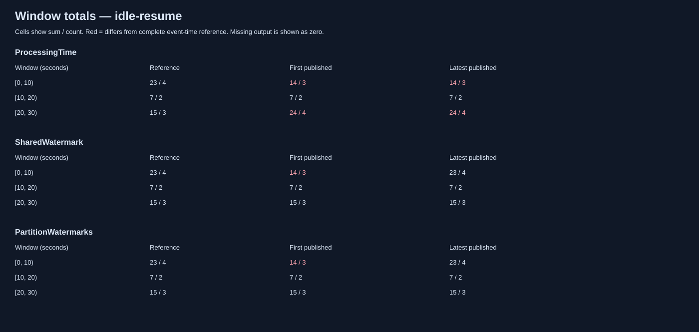

# event-time-watermark

A deterministic **.NET 10** stream-processing simulator showing how successfully
received messages can still produce incorrect time-window analytics.

Replay the same dataset through processing-time aggregation, a shared event-time
watermark, and per-partition watermarks. Compare every result against an independent
offline reference, then inspect event delays, idle partitions, window emissions,
and late corrections in SVG timelines.

## Run

Requires the .NET 10 SDK. There are no NuGet package dependencies, brokers,
background services, or wall-clock sleeps.

```powershell
dotnet build -c Release
dotnet run --project tests/EventTimeWatermark.Tests -c Release
dotnet run --project src/EventTimeWatermark.Cli -c Release -- demo
```

Open `artifacts/demo/timeline.svg` and `artifacts/demo/windows.svg` in a browser.
The tests are an executable assertion harness: use `dotnet run`, not `dotnet test`.
Failures exit nonzero.

For the assertion suite plus CLI scenario/policy, sweep, and invalid-input checks,
run `pwsh -File scripts/verify.ps1` (PowerShell 7).

The default demo has three sources, a temporarily idle partition, a 3-second
watermark delay, an 8-second idle timeout, and a 10-second correction period:

| Strategy | Final wrong windows | Absolute sum error | Corrections |
| --- | ---: | ---: | ---: |
| Processing time | 2 | 18 | 0 |
| Shared watermark | 0 | 0 | 1 |
| Partition watermarks | 0 | 0 | 1 |

Both event-time strategies initially miss a value of 9 and repair it with a
replacement emission. The processing-time strategy accepts every message but
assigns that value to the wrong window.



[View the complete timeline](docs/examples/timeline.svg).

## Experiments

```powershell
# Fast source advances shared progress ahead of a slower source.
dotnet run --project src/EventTimeWatermark.Cli -- compare --scenario skew

# Retain rejected events separately.
dotnet run --project src/EventTimeWatermark.Cli -- compare --scenario correction --watermark-delay 0s --late-policy side-output

# Repair one late event; reject another after correction expiry.
dotnet run --project src/EventTimeWatermark.Cli -- compare --scenario correction --watermark-delay 0s --late-policy correct --correction-period 10s

# Compare completeness, latency, and retained state across watermark delays.
dotnet run --project src/EventTimeWatermark.Cli -- sweep --scenario mixed --watermark-delays 0s,2s,5s,10s --seed 42

# Exclude silent partitions from the minimum watermark.
dotnet run --project src/EventTimeWatermark.Cli -- compare --scenario idle-resume --idle-timeout 8s

dotnet run --project src/EventTimeWatermark.Cli -- help
```

`compare` and `sweep` default to `mixed`, discard policy, and disabled idleness.
`--output` selects the output directory; existing generated filenames there are
replaced. Durations accept seconds or milliseconds, including `0.5s`, with whole
millisecond precision and a maximum of 24 hours. Zero idle timeout is invalid;
use `off` to disable it. Unknown/repeated options and invalid inputs exit with code 1.

## Scenarios

| Name | Sources | Purpose |
| --- | ---: | --- |
| `ordered` | 2 | Baseline where arrival and event-time windows agree |
| `boundary` | 2 | Event at 9s arrives at 12s and enters the wrong processing-time window |
| `skew` | 2 | Shared watermark discards a value of 9; partition minimum preserves it |
| `idle-resume` | 3 | Idle exclusion advances progress; resumed old data needs a correction |
| `correction` | 2 | With zero watermark delay, value 9 is corrected and value 11 expires |
| `mixed` | 3 | 180 seeded events with disorder, long delays, and a partition delivery pause |

The generator uses a fixed xorshift32 algorithm, independent of runtime `Random`
implementation changes. Seed zero maps to the fixed nonzero state `0x9E3779B9`.
The core API also accepts custom `Scenario` instances; the CLI uses built-in scenarios.

## Time and watermark contract

Events contain a unique ID, partition ID, event timestamp, arrival timestamp,
and integer value. Times are nonnegative integer milliseconds from a synthetic
epoch; arrival must be at or after event time. Arithmetic is checked for overflow.

- Windows are fixed half-open intervals: `[0,10000)`, `[10000,20000)`, etc.
- Count and sum are aggregated across partitions in each window.
- Replay order is `(ArrivalTimeMs, Id)`, independent of input-list order.
- Processing-time timers fire before arrivals at their boundary, including during silence.
- Equal-time arrivals are processed as a batch before event-time watermark advancement.
  Each arrival is classified against the previously published watermark.
- Shared progress is `max(event time observed anywhere) - delay`.
- Partition progress is `max(event time observed in partition) - delay`.
  Global progress is the minimum across active partitions, clamped to its previous value.
- An unseen active partition holds progress at negative infinity. Initial silence is
  measured from virtual time zero. An idle timeout excludes a partition from the minimum;
  arrival at exactly its timeout wins over idleness.
- A resumed partition cannot roll back global progress. It can hold future progress
  back until it catches up. If every partition is idle, progress freezes.
- Emit when `watermark >= windowEnd`. Empty windows are not emitted.
- All sources explicitly complete together at the first 10-second boundary strictly
  after the last arrival. The trace records each source's completion and a terminal
  watermark, flushing retained state. The simulator does not use future knowledge
  to infer an individual partition's early completion. Completion flushes are included
  in latency metrics, so compare runs with the same scenario.

Watermarks are estimates subject to assumptions, not proof that older events cannot
arrive. This is an educational model, not an implementation-compatible Flink emulator.
Related concepts: [Flink event time](https://nightlies.apache.org/flink/flink-docs-release-2.3/docs/concepts/time/)
and [watermark generation and idleness](https://github.com/apache/flink/blob/master/docs/content/docs/dev/datastream/event-time/generating_watermarks.md).

## Late events and corrections

An event is *behind the watermark* when `eventTime < watermark`. It targets a closed
window when `windowEnd <= watermark`. These conditions are counted separately:
an event behind the watermark can still belong to an open window.

| Policy | Closed-window behavior |
| --- | --- |
| `discard` | Ignore and increment discarded events |
| `side-output` | Preserve the event and reason in a separate output; do not count it as discarded |
| `correct` | Accept while `watermark < windowEnd + correctionPeriod`; otherwise discard as expired |

The correction period is measured in **watermark progress**, not elapsed processing
time. Idle/stalled watermarks can therefore retain state for a long time. A zero
correction period behaves like discard for closed windows.

Each correction publishes a full replacement `(windowStart, version, count, sum)`.
Consumers must upsert by window start rather than add successive versions. A late
event may create a previously empty window within retention; this emits version 1
with kind `late-create`. Initial accuracy means the first actual publication for
each window, including such late creations; final accuracy uses its latest version.

## Outputs and metrics

| File | Contents |
| --- | --- |
| `report.json` | Input events, settings, reference, metrics, versioned results, trace, latency arrays |
| `trace.jsonl` | Arrivals, partition/global watermarks, idle/resume, emissions, finalization, source completion |
| `late-events.jsonl` | Side-output records, tagged by strategy |
| `timeline.svg` | Event/arrival links, partition/global step curves, idle shading, emission markers |
| `windows.svg` | Reference, first, and latest sum/count for every window |
| `sweep.csv` | One summary row per delay and strategy; each delay also gets a full report directory |

SVG markers have hover titles with exact event and window details. Negative initial
watermarks and the terminal infinity sentinel are omitted from the chart. The
processing-time panel shows fired clock boundaries, not an event-time watermark.
The JSON trace uses `long.MinValue`/`long.MaxValue` as infinity sentinels.

Accuracy compares the union of reference and output windows; absent windows count
as zero. Wrong-window count checks both sum and count. Absolute errors sum per-window
differences, so moving value 9 between windows produces sum error 18.

Initial-emission and finalization latency are virtual processing time minus window
end. `report.json` contains each sample; sweep CSV contains means. Missing windows
have no latency sample, so latency must be interpreted together with accuracy.

`MaxOpenWindows`, `MaxRetainedCorrectionWindows`, and `MaxWindowStates` measure peak
aggregation-state counts. Count/sum use incremental accumulators: `MaxBufferedEvents`
is zero. Input storage, scheduler, output history, and diagnostic trace are excluded
from processor-state metrics. These are state-count proxies, not measured heap bytes.

`ProcessingOperations` sums events handled, aggregate updates, watermark evaluations,
window inspections, and emissions. It is a documented logical-work counter, not CPU
instructions, elapsed runtime, or a claim about production-engine throughput. The
simple reference simulator scans retained windows when progress advances.

## Layout and validation

```text
src/EventTimeWatermark.Core/   Models, scenarios, reference, simulation, reports
src/EventTimeWatermark.Cli/    Commands and option validation
tests/EventTimeWatermark.Tests/  Executable deterministic assertion suite
docs/examples/                Checked-in demo SVGs
```

Tests cover half-open boundaries, reference totals, deliberately wrong results,
shared versus partition progress, correction expiry equality, idle/resume behavior,
simultaneous arrivals, timer firing during silence, validation failures, 50 seeded
datasets across strategies/policies, event accounting, monotonic watermarks, and
byte-stable reports. A sufficient watermark delay must match the independent reference.

No duplicate delivery, retries, clock skew, persistence, network transport, backpressure,
or exactly-once guarantees are modeled. The subject is correctness of time-dependent
aggregation, rather than queue capacity or overload.
